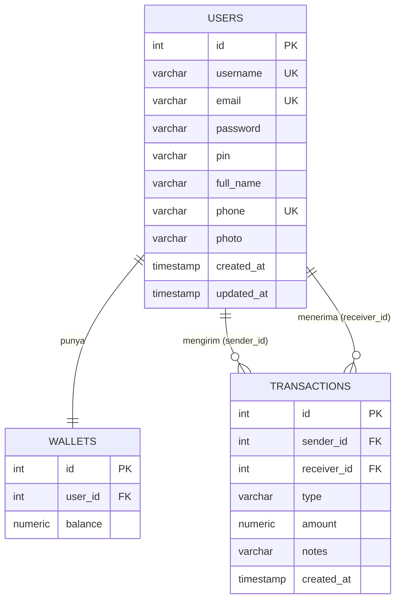

# EWallet Database (PostgreSQL)

Database sederhana untuk project EWallet, terdiri dari 3 tabel.

## ERD



> Ganti bagian ini dengan screenshot ERD (lihat petunjuk di bawah).

## Penjelasan Tabel

| Tabel | Fungsi |
|---|---|
| `users` | Data akun & profil (password dan PIN disimpan dalam bentuk hash) |
| `wallets` | Saldo tiap user (1 user = 1 wallet) |
| `transactions` | Riwayat topup & transfer. Topup: `sender_id` kosong. Transfer: pengirim & penerima terisi |

Income = transaksi di mana user adalah receiver, expense = transaksi di mana user adalah sender.

## File

- `schema.sql` : membuat tabel
- `koda-b1-weekly.sql` : semua query yang dibutuhkan

## Cara Menjalankan

```bash
psql -U postgres -d ewallet -f schema.sql
```